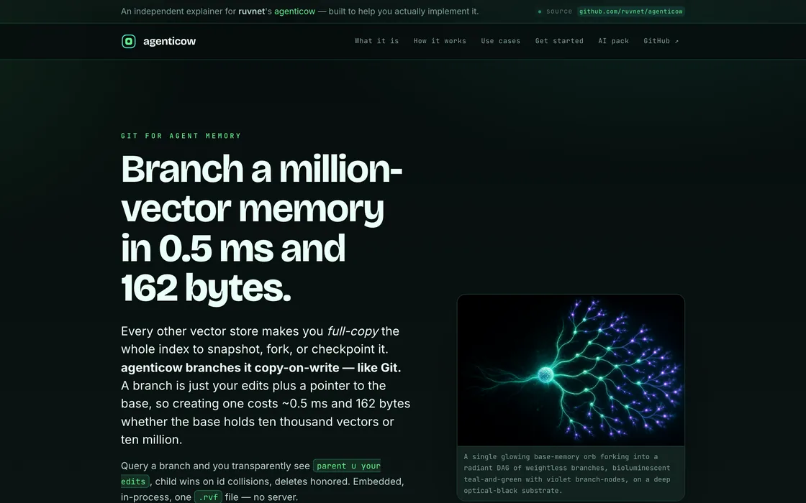
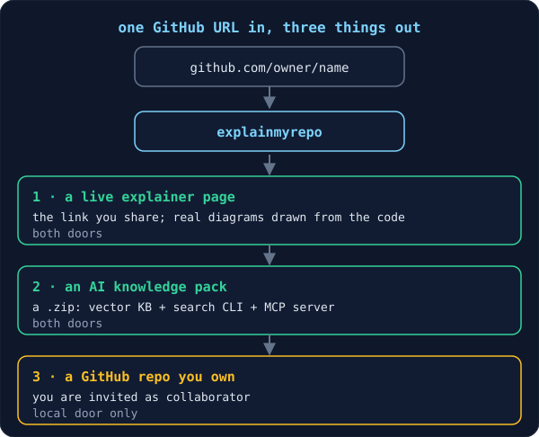
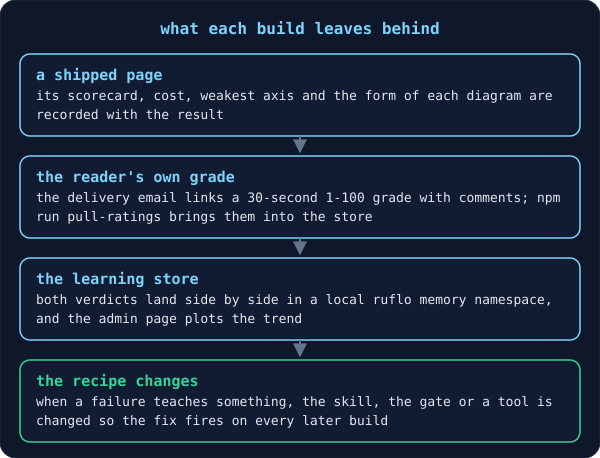
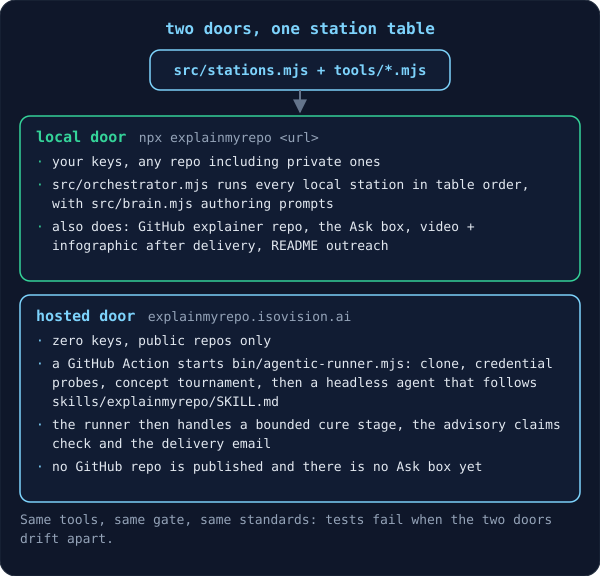
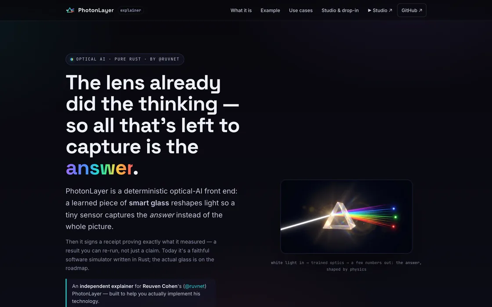
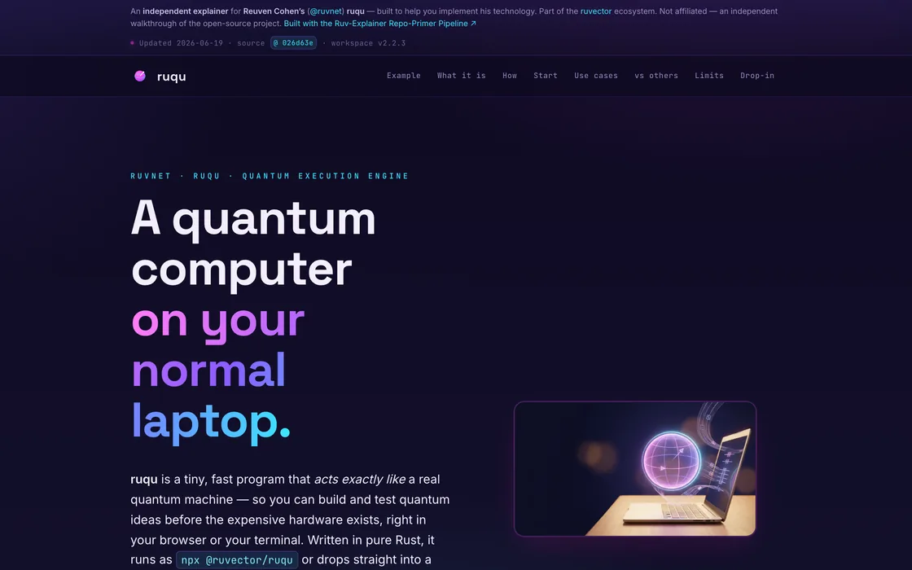
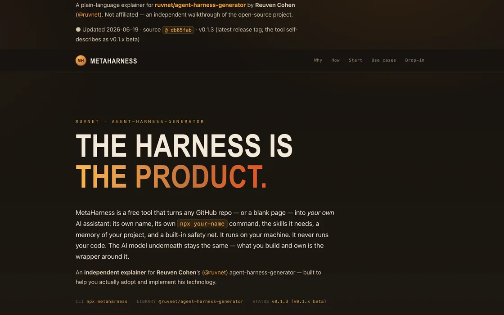
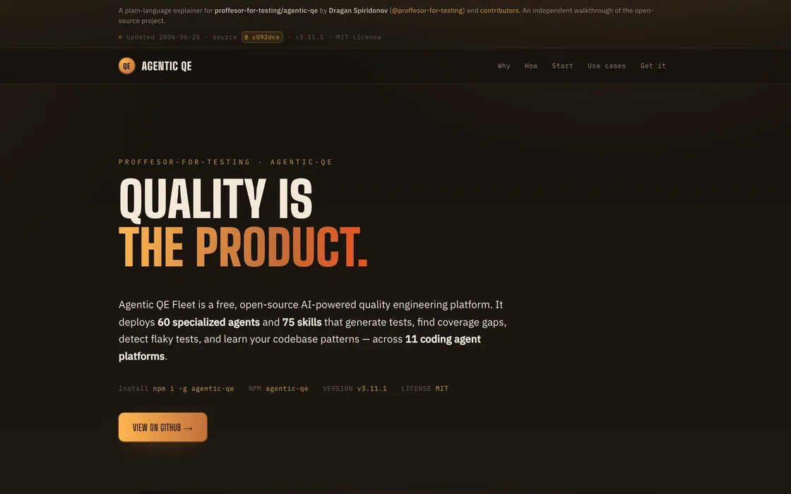

<div align="center">

# explainmyrepo

### Point it at any GitHub repo. Get back an explainer a stranger — and their AI — actually understands.

## The website

# → **[explainmyrepo.isovision.ai](https://explainmyrepo.isovision.ai)** ←

Paste a public repo's URL, get the page by email. Private repos and your own keys: use the command below.

*Complex repos deserve clear introductions. This builds them, grades them honestly, and tells you the grade.*

</div>

[](https://agenticow-explainer.netlify.app/)

<p align="center"><em>↑ a real one — generated end to end from <a href="https://github.com/ruvnet/agenticow">ruvnet/agenticow</a>, no human design pass. <a href="https://agenticow-explainer.netlify.app/">Open it live.</a></em></p>

---

## The problem it solves

Most repositories are opaque. Open one cold and you can't quickly tell **what it is**, **why it matters**, **how it's built**, or **how to use it**. The README is usually a wall of text written by someone who already knows the answer — so it assumes you do too.

That hurts twice over now:

- **A human** lands on your repo, doesn't get it in thirty seconds, and leaves.
- **An AI** (Claude Code, Cursor) is asked about your repo and *guesses*, because it has no grounded understanding of the actual source.

A longer README doesn't fix opacity. The goal is bigger than documentation:

> Take someone from *"I've never seen this before"* to *"Oh, I get why this was created, the problem it solves, what it does, why it's elegant, how it works — and I'm ready to go implement it."*

That's the bar. `explainmyrepo` exists to clear it, on every build.

---

## What you get from one command



<details>
<summary>ASCII Version (for AI/accessibility)</summary>

```
github.com/owner/name
        |
        v
  explainmyrepo
        |
        +--> 1. a live explainer page          (both doors)  the link you share; diagrams drawn from the code
        +--> 2. an AI knowledge pack           (both doors)  a .zip: vector KB + search CLI + MCP server
        +--> 3. a GitHub repo you own          (local door only)  you are invited as collaborator
```

</details>

1. **A live explainer web page** — a bespoke, art-directed walkthrough with an architecture diagram and a flow diagram drawn from the repo's real dependency graph and entrypoints, never invented.
2. **A downloadable AI knowledge pack** — a `.zip` with a vector knowledge base of the repo, a search CLI and an MCP server, so Claude Code or Cursor answer from the **real source** instead of guessing.
3. **A GitHub repo you own** *(local door only)* — the explainer gets its own repo and you are invited as a collaborator, so you can edit it.

---

## How it works — one station table

`explainmyrepo` is not a template filler. The judgment (understand, conceive, author, judge) is done by a model; small, deterministic **tools** do the mechanics; one `build.json` carries the data between them. The order of every step lives in **one file**, [`src/stations.mjs`](src/stations.mjs), and the CLI help, the `--from/--to/--only` checks and the tests all read it; a drift test fails if the hosted station table in `skills/explainmyrepo/SKILL.md` stops matching the hosted tool stations here (same set, same order).


<details>
<summary>ASCII Version (for AI/accessibility)</summary>

```
1 set up         clone-repo > kb:register > build-kb > concept-tournament (advisory)
2 build + grade  primer > index-primer > concept > content > check-claims (advisory) > visual-brief
                 > generate-image > make-favicon > make-social-card > make-diagrams > assemble-page
                 > make-pack > make-ask (advisory, local) > quality-grade
3 ship           deploy > publish-repo (local) > repo-seo (local) > readme-enhance (local, advisory) > notify (advisory)
4 follow-ups     make-overview (local) > redeploy (local) > republish (local)     all advisory, after delivery

solid = a failure stops the build   dashed = advisory, the build carries on   L = local door only
```

</details>

In plain words:

1. **Read** — clone the **exact** repo (identity-pinned, so nothing can substitute a lookalike).
2. **Compete** — before expensive work, three models (Claude Sonnet, Claude Fable, GPT-5.6) each pitch a visual metaphor, palette, hero animation and story arc in plain text; a judge picks one. It is a cheap step that fails open: it needs both an Anthropic and an OpenAI key, and when it skips, a single-shot concept is authored instead.
3. **Understand** — build a real RVF vector knowledge base from the actual code (structure-aware chunks, local 384-dim embeddings, a symbol index, a dependency graph, entrypoints), then author a plain-language primer. Everything downstream is grounded in it.
4. **Author** — write the copy along a comprehension arc for a curious fifteen-year-old: *What world am I in? Why does this exist? What does it do? Why is it clever? How is it built? Could I use it? How do I start?* An advisory check compares the page's citations and commands with the KB.
5. **Visualize** — every image must teach (if it could ship unchanged on a different repo, it fails). Diagrams are **drawn by code** from the real graph, or from the structure the model authored; no two diagrams on a page share a form.
6. **Assemble** — render the page once onto a shared design system and wire in SEO and social: JSON-LD, `llms.txt`, and a required, verified 1200×630 share card.
7. **Grade** — the quality gate, below.
8. **Ship** — deploy to its own Netlify site, verify it answers 200, and email you every link.

---

## The quality gate — it tells you the truth

A generic generator emits something and stops. `explainmyrepo` renders the page in a real browser and grades it. **The gate advises; it does not veto** ([ADR-0011](docs/adr/0011-the-gate-advises-never-destroys.md)): a below-bar page is delivered with its weakest axis named, instead of the requester getting nothing.


<details>
<summary>ASCII Version (for AI/accessibility)</summary>

```
1 render for real      390px phone + 1440px desktop, full-page screenshots
2 free checks first    INV-20 unexplained jargon, INV-24 reads at fifteen (no model call)
3 vision critic        11 axes (A1-A6 substance, B1-B5 craft) + six operator questions
                       mean 79-85: graded twice, samples merged
verdict
  exemplary      mean 90+, min axis 85+, all six YES
  ships          mean 82+, min axis 70+, five ship questions YES, both diagrams present
  below the bar  still ships, its weakest axis named to the requester
At most 3 grading passes. Deploy refuses only on integrity: unassembled page, a different repo
than submitted, a page linking files it does not ship, or no scorecard with no recorded reason.
```

</details>

The gate scores two independent rubrics:

- **Gate A — "Do they actually get it?"** (substance): visual effectiveness, storytelling, clueless-to-convinced, usefulness to *you*, completeness of the arc, implementation confidence.
- **Gate B — "Did someone who cares make this?"** (craft): typography, alignment, spacing, polish, and imagery craft, including whether the diagrams explain anything.

Six operator questions sit beside the numbers (understand it? approachable? explainable to a novice? confident about the architecture? makes me smile? could a zero-knowledge reader follow the first four sections?). The minimum-axis floor is the anti-slop catch: one weak axis fails a tier no matter how good the mean is. The reader on every page is a curious fifteen-year-old, and two free checks measure that before a single vision token is spent.

---

## The factory learns



<details>
<summary>ASCII Version (for AI/accessibility)</summary>

```
a shipped page --> scorecard, cost, weakest axis, diagram forms are recorded
      |
      v
reader's own grade (1-100 + comments, linked from the delivery email; npm run pull-ratings ingests them)
      |
      v
learning store (local ruflo memory namespace; the admin page plots the trend)
      |
      v
the recipe changes: when a failure teaches something, the skill, the gate or a tool is changed
```

</details>

Lessons live in the recipe (the skill, the gate, the tools), not in anyone's memory, so a fix fires on every later build.

---

## Two doors



<details>
<summary>ASCII Version (for AI/accessibility)</summary>

```
                 src/stations.mjs + tools/*.mjs
                    /                      \
   local door                               hosted door
   npx explainmyrepo <url>                  explainmyrepo.isovision.ai
   your keys, any repo incl. private        zero keys, public repos only
   src/orchestrator.mjs runs every          GitHub Action -> bin/agentic-runner.mjs: clone, credential
   local station (authoring: src/brain.mjs) probes, concept tournament, then a headless agent that follows
   also: explainer repo, Ask box,           skills/explainmyrepo/SKILL.md; the runner adds a bounded cure
   video + infographic, README outreach     stage, the claims check and the delivery email
                                            no GitHub repo, no Ask box yet
```

</details>

**Pick your door with one question — is the repo public, and whose keys should do the work?** Public repo and you just want the page: use the website. Private repo, or you want it on your own accounts: use the CLI, and run it **inside a VS Code / Claude Code session** in a project whose `.env` already holds your keys, so everything is picked up automatically. (`/explainmyrepo <url>` inside Claude Code runs the same skill by hand.)

The two doors stay in step by test, not by hope: `tests/two-doors-conform.test.mjs` pins the reader standard and the image rules in both places, and a drift test parses the hosted station table in `skills/explainmyrepo/SKILL.md` and fails unless it lists exactly the hosted tool stations of `src/stations.mjs`, in the same order (the brain stations and the runner's own prose are checked more loosely: each both-door station must be named somewhere the hosted agent reads).

---

## Local door: every explainer can answer follow-up questions

Pages built by the **local door** end with an **Ask box**: type a question in plain words and get a short written answer with numbered links to the exact files it came from. It searches the page and the repo's own files in the reader's browser, then a small model writes the answer through one central service ([`ask-service/`](ask-service/README.md)), so the explainer itself stays a plain static site. If the service is down it shows the closest passages and says so. Set `ASK_SIGNING_SECRET` (the same value on the service and your build machine) to turn on written answers; `ASK_DISABLE=1` leaves the box off. The service screens every question and every answer with AIMDS and fails closed. Hosted-door builds do not get the box yet. Deploy also refuses a page that links a file it does not ship. See [ADR-0016](docs/adr/0016-ask-this-project.md).

---

## Get started

```bash
# Point it at any GitHub repo. Walk away. Get back a live page and an AI pack.
npx explainmyrepo https://github.com/owner/repo
```

**What you need** (the command checks all of this up front and tells you exactly what's missing):

| For | What | Notes |
|---|---|---|
| The brain | `ANTHROPIC_API_KEY`, **or** `OPENROUTER_API_KEY`, **or nothing** if you're logged into Claude Code | any one of the three is enough. With an Anthropic key (or Claude Code login) authoring runs on `claude-sonnet-5-5`. With **only** an OpenRouter key it runs on `z-ai/glm-5.3`; set `EXPLAINMYREPO_AUTHORING=openrouter` to choose it on purpose or `=anthropic` to refuse it |
| Art + quality gate | `OPENAI_API_KEY` in `.env` | hero imagery (`gpt-image-2.5-flare`, falling back to `gpt-image-2`, then Grok when there is no OpenAI key or the OpenAI chain fails) and the vision grader |
| **ImageMagick** | `magick` (v7) or `convert` (v6) on your `PATH` | **required** — the favicon and share-card stations shell out to it and fail loudly without it. `brew install imagemagick` on macOS, `apt install imagemagick` on Debian/Ubuntu |
| The live URL | `NETLIFY_AUTH_TOKEN` in `.env` | required unless you pass `--no-deploy` (the preflight stops without it); with `--no-deploy` you still get the complete page locally |
| Private repos | `gh auth login` | public repos need nothing |

**The count, plainly:** website — **zero keys**. npx **inside Claude Code** (recommended) — **one key** (OpenAI); add a Netlify token for the live URL (or pass `--no-deploy`). npx in a bare terminal — **two keys** (add Anthropic). Private repo — no extra key, just `gh auth login` once.

**Recommended:** run it inside a **VS Code / Claude Code session** in a project whose `.env` already has these — nothing to export, nothing to paste, and Claude Code itself carries the brain on your existing subscription.

**What you get back:** a live URL (in your terminal and by email), the downloadable AI pack, and on the local door a GitHub repo you're a collaborator on — plus the scorecard and both screenshots, so you're the final set of eyes.

> **Status:** `npx explainmyrepo` is **live on npm** (3.x). The hosted website is live at [explainmyrepo.isovision.ai](https://explainmyrepo.isovision.ai). Found it valuable? **[A star on this repo](https://github.com/stuinfla/Repo-Explainer)** genuinely helps. Hit a problem? **[Open an issue](https://github.com/stuinfla/Repo-Explainer/issues)** — happy to help fix it and make it better.

**Don't want to pay per token for the authoring brain?** The same skill runs through a **Codex** session signed in with a ChatGPT subscription, which drops the text-model cost to $0 (only `gpt-image-2.5-flare` imagery stays metered). It also builds straight from a **local checkout**, so private source never leaves the machine. See [`docs/prompts/codex-explainer-build.md`](docs/prompts/codex-explainer-build.md) for the setup and a copy-paste prompt template.

**Contacting maintainers.** After a local build ships, the readme-enhance station opens **one** friendly GitHub issue showing the maintainer a better README for their repo (their README exactly as written, plus an explainer link and diagrams), and offers a pull request only if they say yes. Never your own repo or a private one, one contact per repo, at most five a day. A single check-in note, sent only by running `npx explainmyrepo outreach followup` a week or more later, is posted only if they have not replied, and any maintainer-email draft goes to you, never to them. Switch it off with `--no-readme-pr` or `README_ENHANCE=0`. See [ADR-0015](docs/adr/0015-readme-outreach-issue-first.md).

---

## See a real one

The agenticow explainer above was generated end to end from [`ruvnet/agenticow`](https://github.com/ruvnet/agenticow): a captivating hero, a plain-language walkthrough, **an architecture diagram and a data-flow diagram drawn from agenticow's own code**, concrete use-cases, and a one-click AI knowledge pack.

### [Open the live agenticow explainer →](https://agenticow-explainer.netlify.app/)

Earlier hand-built explainers the bar is calibrated against — five completely different looks, same engine, same gate:

| | | |
|---|---|---|
| [](https://photonlayer-explainer.vercel.app/) | [](https://ruqu-explainer.vercel.app/) | [](https://ruvn-explainer.vercel.app/) |
| [**PhotonLayer**](https://photonlayer-explainer.vercel.app/) — optical-AI: light computes the answer before any chip wakes up. | [**ruqu**](https://ruqu-explainer.vercel.app/) — a quantum-computing simulator in your browser (Rust + WASM). | [**ruvn**](https://ruvn-explainer.vercel.app/) — turns a question into a graded, cited evidence dossier. |
| [](https://metaharness-explainer.vercel.app/) | [](https://agentic-qe-explainer.vercel.app/) | [](https://agenticow-explainer.netlify.app/) |
| [**MetaHarness**](https://metaharness-explainer.vercel.app/) — gives any project its own AI assistant that knows *that* project. | [**Agentic QE**](https://agentic-qe-explainer.vercel.app/) — replaces manual testing with a fleet of specialist AI agents. | [**agenticow**](https://agenticow-explainer.netlify.app/) — git for agent memory: copy-on-write vector branching. |

---

## Built with

| Layer | Tool |
|---|---|
| Concept tournament | Claude Sonnet 5.5 · Claude Fable 5.1 · GPT-5.6 Sol competing in text; GPT-5.6 Terra judging |
| Authoring brain | `claude-sonnet-5-5` by default; `z-ai/glm-5.3` via OpenRouter only as the sole credential or by opt-in |
| Knowledge base | RVF single-file vector DB (`@ruvector/rvf`) + a local embedder named by each target's `embed` block (`bge-small-en-v1.5`, 384-dim, for every registered target) |
| Imagery | `gpt-image-2.5-flare` at `xhigh`, then `gpt-image-2`, then Grok when there is no OpenAI key or the OpenAI chain fails (labeled, mechanism-bearing illustration) · diagrams drawn deterministically as SVG by `tools/make-diagrams.mjs` |
| Quality gate | Playwright dual-viewport render + GPT-5.6 Sol vision grading (`QUALITY_VISION_MODEL`) — ship tier 82/70, exemplary tier 90/85, deploy refuses only on integrity |
| Feedback + learning | Reader 1–100 grades beside machine grades; outcomes feed a local learning store |
| Companions (local) | [HyperFrames](https://github.com/heygen-com/hyperframes) — a page's own assets re-rendered into a trailer and a social loop, locally |
| Hosting | Netlify, one site per explainer |

Prices for `gpt-image-2.5-flare` are not published to us, so cost receipts say **unpriced** for it rather than guessing; rates for the Anthropic models come from third-party price lists, not a bill.

The founding decision is [`docs/adr/0005-skill-based-explainer-recipe.md`](docs/adr/0005-skill-based-explainer-recipe.md) (read its banner first: later ADRs 0006–0016 supersede parts of it); the slot-by-slot data contract is [`tools/CONTRACT.md`](tools/CONTRACT.md); every tool's own header is collected in [`skills/explainmyrepo/TOOLS-CONTRACT.md`](skills/explainmyrepo/TOOLS-CONTRACT.md), which a test keeps in step with the tools.

## The Alive Kit — what a finished page can become (local runs only)

A gated build's assets are reusable creative truth, so this repo can turn a finished explainer into **companion artifacts** — but only when you clone it and run them yourself, and only for capabilities that have actually been **proven**:

```
npx explainmyrepo capabilities
```

That command renders the verified-capability registry (`capabilities.json`) — the *only* source of what's enabled, so it can never overstate. Companions never run on the hosted door, never touch a build's artifacts, and can never block a page from shipping. Governance: [`docs/adr/0009-alive-kit-local-companions.md`](docs/adr/0009-alive-kit-local-companions.md).

---

## Known limits

Plainly, as of this release:

- **The Ask box is local-door only.** Hosted-door pages do not have one yet.
- **The hosted door cannot yet move deploy into the runner.** The hosted agent still runs `deploy` itself; the runner only retries and cures around it.
- **Image prices are partly unknown.** `gpt-image-2.5-flare` has no known per-image price, so cost totals leave it out and say so.
- **Story diagrams on a phone.** Every diagram is drawn twice, wide and as a 360px phone twin, and `make-diagrams` fails the step if any label would be under 11px on a 390px phone. The story diagrams (system map, decision) have been exercised on fewer real builds than the radial architecture map.
- **Hero scenes are untested against a live model.** The local brain now authors an animated hero scene and a valid one replaces the raster hero, but the validator and repair pass have been proven on fixtures, not across real builds.
- **Page weight is checked, not tuned.** `deploy` and the site check fail a page whose images total over 1.5 MB (lightbox originals are not counted) and warn when the first view (gzipped HTML + CSS + the images above the fold) passes 300 KB (`src/site-check.mjs`). Image files are not content-fingerprinted and `deploy` writes no `_headers` file, so pages use Netlify's default revalidating cache; fingerprinted long-cache filenames would need `tools/deploy.mjs` to emit a `_headers` file first, and that is not built.
- **No branch protection on `main` yet.** CI runs on every pull request, but nothing forces it.
- **Outreach response rates are unmeasured.** The ledger exists to find out; no claim is made yet.

## Credit

The tools in the examples above belong to [Reuven Cohen / @ruvnet](https://github.com/ruvnet). `explainmyrepo` is an independent project that exists to help more people — and their AIs — discover, understand, and adopt great work.

---

<div align="center">

Built by **[Stuart Kerr](https://stuart-kerr-card.netlify.app)** at **[ISOvision.ai](https://isovision.ai)**.

*Complex repos deserve clear introductions.*

</div>
